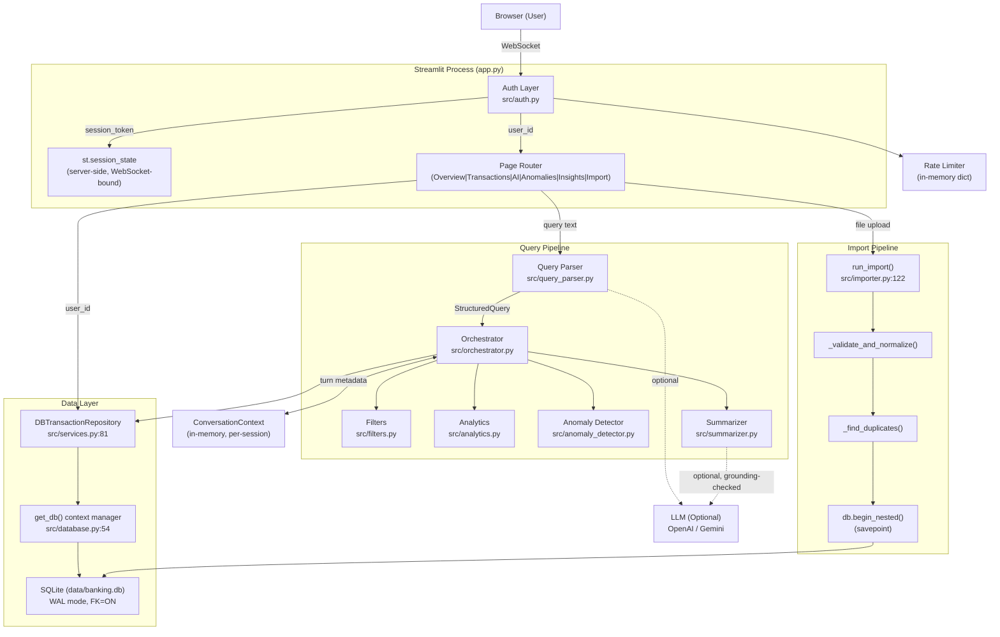

# Phase 8 — Database and Data-Flow Audit Report

**Date:** 2026-10-27  
**Scope:** Read-only audit of commit `6fa1d4a` (Phase 7) on `master`  
**Phase 6 preserved at:** `141522a`  
**Constraint:** No files modified, no data mutated, no commits made

---

## 1. Executive Summary

The Banking Assistant Agent stores all persistent data in a single SQLite database (`data/banking.db`) via SQLAlchemy 2.x with Alembic migrations. Four ORM models (`User`, `FinancialAccount`, `Transaction`, `ImportRecord`) enforce referential integrity through foreign keys with cascade rules. User isolation is enforced at the **service/repository layer** — every data-access path joins on `user_id`, verified by 16 dedicated cross-user tests including adversarial attack paths. Transient state (session tokens, conversation context, rate-limiting counters) lives in Streamlit's server-side `session_state` and in-memory Python dicts, and is lost on process restart. The optional LLM receives only pre-computed numbers via `AnalysisSummaryInput` and its output is grounding-checked (2% tolerance) before display.

**Verdict:** Within the scope of this audit (static code inspection of all data-access paths and review of 16 dedicated cross-user automated tests), no cross-user data leakage path was identified. This does not constitute exhaustive proof of isolation — it reflects what code inspection and the existing test suite cover. Two architectural limitations (in-memory rate limiting, Streamlit session management) are documented and acknowledged. One low-severity finding (dead `except` in `app.py:1193`) carries over from Phase 6.

---

## 2. Architecture Diagram



---

## 3. Database Schema

**Engine configuration** (`src/database.py:19-51`):
- `DATABASE_URL` from env, default `sqlite:///data/banking.db`
- SQLite PRAGMAs set via `@event.listens_for(engine, "connect")`:
  - `journal_mode=WAL` — concurrent readers, single writer
  - `foreign_keys=ON` — FK constraints enforced
- `SessionLocal = sessionmaker(bind=engine, expire_on_commit=False)`

**Migration:** Single Alembic revision `d1b0c82c90a1` creates all 4 tables. Schema matches ORM models exactly.

### Table: `users`

| Column | Type | Constraints |
|--------|------|-------------|
| `id` | Integer | PK, auto-increment |
| `username` | String(80) | UNIQUE, NOT NULL, indexed |
| `email` | String(255) | UNIQUE, NOT NULL, indexed |
| `password_hash` | String(255) | NOT NULL |
| `is_active` | Boolean | default True |
| `created_at` | DateTime | server_default=now() |

### Table: `financial_accounts`

| Column | Type | Constraints |
|--------|------|-------------|
| `id` | Integer | PK, auto-increment |
| `user_id` | Integer | FK → `users.id` CASCADE, NOT NULL, indexed |
| `name` | String(100) | NOT NULL |
| `account_type` | String(50) | NOT NULL |
| `currency` | String(10) | default "INR" |

### Table: `transactions`

| Column | Type | Constraints |
|--------|------|-------------|
| `id` | Integer | PK, auto-increment |
| `external_id` | String(100) | indexed (uuid4 default) |
| `account_id` | Integer | FK → `financial_accounts.id` CASCADE, NOT NULL |
| `import_id` | Integer | FK → `import_records.id` SET NULL, nullable |
| `date` | Date | NOT NULL |
| `description` | String(500) | |
| `merchant` | String(200) | |
| `category` | String(100) | |
| `txn_type` | String(20) | NOT NULL ("Debit"/"Credit") |
| `amount` | Numeric(15,2) | NOT NULL |
| `currency` | String(10) | default "INR" |
| `original_description` | String(500) | |
| `created_at` | DateTime | server_default=now() |

Composite index: `(account_id, date)`.

### Table: `import_records`

| Column | Type | Constraints |
|--------|------|-------------|
| `id` | Integer | PK, auto-increment |
| `user_id` | Integer | FK → `users.id` CASCADE, NOT NULL, indexed |
| `filename` | String(255) | NOT NULL |
| `file_type` | String(20) | NOT NULL |
| `rows_total` | Integer | default 0 |
| `rows_imported` | Integer | default 0 |
| `rows_skipped` | Integer | default 0 |
| `rows_duplicate` | Integer | default 0 |
| `status` | String(50) | default "pending" |
| `error_message` | Text | |
| `created_at` | DateTime | server_default=now() |

### FK Cascade Rules

| Parent → Child | ON DELETE |
|----------------|-----------|
| `users` → `financial_accounts` | CASCADE |
| `users` → `import_records` | CASCADE |
| `financial_accounts` → `transactions` | CASCADE |
| `import_records` → `transactions` | SET NULL |

---

## 4. Import-to-Answer Trace

### 4.1 Registration (creates data containers)

```
Browser → page_auth() [app.py:505]
  → register(db, username, email, password) [src/auth.py:134]
    → validates username: ^[a-zA-Z0-9_.-]+$, 3-80 chars
    → validates email: ^[^@\s]+@[^@\s]+\.[^@\s]+$
    → validates password: ≥8 chars
    → create_user(db, ...) [src/services.py:34]
      → creates User row
      → creates FinancialAccount(name="Primary", account_type="checking")
      → single transaction, both committed together
```

### 4.2 Login (establishes session)

```
Browser → page_auth() [app.py:518]
  → login(db, username, password) [src/auth.py:110]
    → _check_rate_limit(username) [in-memory dict, per-username]
    → authenticate_user(db, username, password) [src/services.py:56]
      → looks up by username, checks is_active, verifies bcrypt hash
    → sets st.session_state:
        authenticated = True
        user_id = user.id
        username = user.username
        session_token = secrets.token_hex(32)
        session_created_at = time.time()
```

### 4.3 CSV Import (data enters database)

```
Browser uploads file → page_import() [app.py:1131]
  user_id = get_current_user_id()  ← from session_state
  → read_upload(file_bytes, filename) → raw DataFrame
  → auto_map_columns(raw_df) → column mapping dict
  → User reviews mapping in UI, clicks Import
  → with get_db() as db:
      account = get_default_account(db, user_id)  ← filtered by user_id
      → run_import(db, user_id, account.id, mapped_df, filename, file_type)
        [src/importer.py:122]
        
        Step 1: Ownership check
          account = db.get(FinancialAccount, account_id)
          if account.user_id != user_id → "access denied", return failure
          
        Step 2: Create ImportRecord(user_id=user_id, status="pending")
        
        Step 3: _validate_and_normalize() [line 212]
          → parse dates (pd.Timestamp)
          → parse amounts (strip ₹/Rs./INR/commas, float())
          → reject negative amounts with specific warning
          → normalize txn_type to "Debit"/"Credit"
          
        Step 4: _find_duplicates() [line 299]
          → loads existing user transactions (via account_id)
          → matches (date, merchant.lower(), amount exact, type)
          
        Step 5: Atomic insert
          nested = db.begin_nested()  ← savepoint
          try:
              for each valid, non-duplicate row:
                  db.add(Transaction(account_id=account_id, ...))
              nested.commit()
          except:
              nested.rollback()  ← all inserts undone
              import_record.status = "failed"
              
        Step 6: Update ImportRecord with counts, status="completed"
    
    get_db() commits on success, rollbacks on exception
```

### 4.4 Query → Answer (AI Assistant path)

```
Browser → page_ai_assistant() [app.py:797]
  user_id = get_current_user_id()
  ctx = _get_conversation_context(user_id)  ← in-memory, session-scoped
  
  → Orchestrator(db=db, user_id=user_id) [src/orchestrator.py]
    
    Step 1: Parse query
      → parse_query(query_text) [src/query_parser.py:338]
        → tries parse_with_llm() first (if LLM available)
          → LLM returns JSON → Pydantic-validated to StructuredQuery
          → on any failure → returns None
        → falls back to parse_deterministic()
          → regex/keyword extraction → StructuredQuery
    
    Step 2: Resolve follow-ups (if ctx has prior turns)
      → inherits date_range/category from last turn
    
    Step 3: Load transactions
      → tool_load_transactions(db, user_id)
        → DBTransactionRepository(db, user_id).load()
          → SELECT transactions JOIN financial_accounts
            WHERE financial_accounts.user_id = :user_id
          → returns (DataFrame, LoadReport)
    
    Step 4: Route by intent
      If intent in {trend_analysis, period_comparison, insights_query}:
        → specialized agent function (deterministic Pandas)
        → returns direct_answer text
      Else (main pipeline):
        → tool_analyze_transactions(df, query)
          → apply_filters() [src/filters.py] — Pandas boolean masks
          → calculate_matching_statistics() [src/analytics.py]
          → calculate_category_breakdown() [src/analytics.py]
          → spending_over_time() [src/analytics.py]
        → tool_detect_anomalies(df)
          → _detect_statistical_outliers() — amount > mean + kσ
          → _detect_duplicate_like() — same merchant, ~amount, ~date
          → _detect_rapid_repeated_large() — ≥3 large within 2 days
        → tool_generate_summary(AnalysisSummaryInput)
          → tries LLM summary (if available)
            → _passes_numeric_grounding_check() — 2% tolerance
            → on fail → deterministic template
          → or generate_template_summary()
    
    Step 5: Record turn in ConversationContext (metadata only, 10-turn cap)
    
    Step 6: Return OrchestratorResult → UI renders KPIs, charts, table, summary
```

### 4.5 Dashboard Pages (non-AI paths)

All follow the same pattern:

```
user_id = get_current_user_id()         ← from session_state
df, load_report = _load_user_dataset(user_id)   ← app.py:228
  → with get_db() as db:
      repo = DBTransactionRepository(db, user_id)
      return repo.load()                ← user-scoped SQL query
```

| Page | Function | Data Source | Additional Calls |
|------|----------|-------------|-----------------|
| Overview | `page_overview()` :558 | `_load_user_dataset(user_id)` | `period_comparison()`, `income_expense_over_time()`, `calculate_category_breakdown()`, `top_merchants()` |
| Transactions | `page_transactions()` :704 | `_load_user_dataset(user_id)` | Client-side Pandas filtering |
| Anomalies | `page_anomalies()` :973 | `_load_user_dataset(user_id)` | `detect_anomalies()` |
| Insights | `page_insights()` :1000 | `_load_user_dataset(user_id)` | `_generate_insights()` (local Pandas) |
| Import | `page_import()` :1131 | `get_default_account(db, user_id)` + `get_user_imports(db, user_id)` | `run_import()` |

---

## 5. Persistence Matrix

| Data Item | Storage Location | Survives Restart? | Shared Across Sessions? | Scope |
|-----------|-----------------|-------------------|------------------------|-------|
| User credentials (username, email, password_hash) | SQLite `users` table | Yes | N/A (server-side) | Per-user |
| Financial accounts | SQLite `financial_accounts` table | Yes | N/A | Per-user (FK `user_id`) |
| Transactions | SQLite `transactions` table | Yes | N/A | Per-account → per-user |
| Import records | SQLite `import_records` table | Yes | N/A | Per-user (FK `user_id`) |
| Dashboard KPIs, charts, analytics | **Not persisted** — computed on each page load from transactions via `_load_user_dataset()` (`app.py:228`) → Pandas | N/A (recomputed) | N/A | Per-page-render; reflects current DB state |
| AI Assistant query results | **Not persisted** — computed per query by the orchestrator pipeline | N/A (recomputed) | No | Per-query |
| Session token | `st.session_state["session_token"]` | **No** | No (WebSocket-bound) | Per-browser-tab |
| Authentication state | `st.session_state["authenticated"]` | **No** | No | Per-browser-tab |
| Conversation context (follow-up state) | `st.session_state["conversation_context"]` — a `ConversationContext` Python object (`app.py:786-794`) | **No** — lost on page refresh, tab close, or WebSocket disconnect | No | Per-browser-tab, per-user (guarded by `ctx.user_id != user_id` check) |
| Displayed chat history (AI Assistant) | Rendered from `ConversationContext.turns` in `st.session_state`; contains only query metadata (intent, date range, category, answer preview), not financial data | **No** — same lifecycle as conversation context | No | Per-browser-tab |
| Rate-limiting counters | `src/auth._login_attempts` (dict) | **No** | Yes (process-wide) | Per-username |
| LLM API keys | Environment variables / `.env` | Yes (if in `.env`) | N/A | Process-wide |
| Uploaded file bytes | Streamlit in-memory (not persisted) | **No** | No | Per-request |

---

## 6. User-Isolation Evidence

### 6.1 Service-Layer Enforcement

Every data access path filters by `user_id`:

| Access Path | Code Location | Isolation Mechanism |
|-------------|---------------|---------------------|
| Load transactions | `DBTransactionRepository.load()` `services.py:91-128` | `select(Transaction).join(FinancialAccount).where(FinancialAccount.user_id == self.user_id)` |
| Get accounts | `get_user_accounts()` `services.py:65-68` | `.where(FinancialAccount.user_id == user_id)` |
| Get default account | `get_default_account()` `services.py:71-76` | `.where(FinancialAccount.user_id == user_id)` |
| Import transactions | `run_import()` `importer.py:133-134` | `if account.user_id != user_id: → "access denied"` |
| Get import records | `get_user_imports()` `services.py:140` | `.where(ImportRecord.user_id == user_id)` |
| Conversation context | `_get_conversation_context()` `app.py:786-794` | Checks `ctx.user_id != user_id` → creates new context |

### 6.2 Test Evidence

**16 isolation tests** across two files:

| Test File | Test | What It Verifies |
|-----------|------|-----------------|
| `test_isolation.py` | `test_db_repo_only_returns_own_transactions` | Alice's repo returns only AliceStore, Bob's only BobStore |
| `test_isolation.py` | `test_user_accounts_isolated` | Each user's accounts have correct `user_id` |
| `test_isolation.py` | `test_import_to_other_users_account_denied` | Alice importing to Bob's account → "access denied" |
| `test_isolation.py` | `test_import_records_isolated` | Each user sees only their own import history |
| `test_isolation.py` | `test_nonexistent_user_gets_no_data` | Fabricated user_id=99999 → empty results |
| `test_security.py` | `test_bob_cannot_query_alice_via_orchestrator` | Bob's orchestrator never returns AliceShop |
| `test_security.py` | `test_bob_cannot_load_alice_transactions_via_repo` | Bob's repo never contains AliceShop |
| `test_security.py` | `test_bob_cannot_import_to_alice_account` | Bob importing to Alice's account_id → "access denied" |
| `test_security.py` | `test_bob_cannot_see_alice_import_records` | Bob's imports list excludes alice_secret.csv |
| `test_security.py` | `test_bob_cannot_access_alice_accounts` | Bob's account IDs never overlap Alice's |
| `test_security.py` | `test_direct_account_id_manipulation_denied` | Direct account_id injection → failure |
| `test_security.py` | `test_fabricated_user_id_gets_nothing` | user_id=999999 → empty across all queries |
| `test_security.py` | `test_xss_payload_in_merchant_is_escaped` | `<script>` stored raw but `html.escape()` sanitizes output |
| `test_security.py` | `test_rate_limit_blocks_after_max_attempts` | 3 failures → lockout on 4th |
| `test_security.py` | `test_rate_limit_case_insensitive` | "CaseUser" and "caseuser" share the same counter |
| `test_security.py` | `test_session_expires_after_lifetime` | Expired session → cleared, `is_authenticated()` returns False |

### 6.3 Isolation Gap Analysis

**Methodology note:** The "Evidence Type" column distinguishes how each claim was verified. "Code inspection" means static reading of the source. "Automated test" means a test in the suite that was previously reported as passing (253/253). "Browser-verified" means observed during prior Phase 6 E2E testing. None of these individually constitute proof of complete security; together they provide layered confidence.

| Potential Vector | Status | Evidence | Evidence Type |
|-----------------|--------|----------|---------------|
| Direct SQL injection | **Mitigated** | All queries use SQLAlchemy ORM parameterized queries; no raw SQL strings found | Code inspection |
| Session state manipulation | **Mitigated** | `user_id` flows from `session_state` → service layer; SQL always filters by it | Code inspection |
| Cross-user account_id injection | **Mitigated** | `importer.py:133` checks `account.user_id != user_id` | Code inspection + automated test (`test_direct_account_id_manipulation_denied`) |
| Fabricated user_id | **Mitigated** | Returns empty results | Automated test (`test_fabricated_user_id_gets_nothing`, `test_nonexistent_user_gets_no_data`) |
| UI-level bypass | **Mitigated** | Isolation enforced at service layer, not UI | Code inspection |
| Cross-user orchestrator query | **Mitigated** | Bob's orchestrator never returns Alice's data | Automated test (`test_bob_cannot_query_alice_via_orchestrator`) |
| Session token strength | **Acceptable** | `secrets.token_hex(32)` — 256-bit random token; however, Streamlit's `session_state` transport depends on the WebSocket, not the token | Code inspection; session security is bounded by Streamlit's transport mechanism, not independently verified at the network level |

**Caveat:** This analysis covers the vectors identifiable through code inspection and the existing automated test suite. It does not cover infrastructure-level attacks (network sniffing, server compromise), Streamlit framework vulnerabilities, or attack vectors that would require penetration testing to identify.

---

## 7. AI Grounding Safeguards

### 7.1 What the LLM Receives

The LLM is used in exactly two places:

1. **Query parsing** (`query_parser.py:310`): Receives the user's natural-language query + a system prompt instructing JSON extraction. Output is Pydantic-validated into `StructuredQuery`. On any failure (invalid JSON, validation error, API error) → deterministic parser takes over.

2. **Summary generation** (`summarizer.py`): Receives a pre-built `AnalysisSummaryInput` containing:
   - All pre-computed statistics (totals, averages, counts)
   - Category breakdown
   - Anomaly summaries
   - The LLM's job: write prose from these numbers, never compute its own.

### 7.2 Grounding Check

`_passes_numeric_grounding_check()` (`summarizer.py:140-161`) is a **heuristic safeguard**, not a formal guarantee that every displayed number is correct:

- `_extract_numbers_from_text()` (`summarizer.py:127`) extracts numbers via regex `[\d,]+(?:\.\d+)?`, rounds each to the nearest integer.
- `_allowed_numbers()` (`summarizer.py:98-124`) collects rounded integers from `AnalysisSummaryInput` fields: overall totals, matching stats, category breakdowns (amounts, percentages, counts), and anomaly amounts.
- **Exemptions:** Numbers ≤ 12 and numbers in the range 2000–2100 are always allowed (`summarizer.py:152`). The rationale is that small counts ("4 transactions") and years are low-risk. However, this means an LLM-invented financial figure of ≤ 12 (e.g., "₹10" or "₹12") would pass the check unchallenged, as would any number the LLM happens to produce in the year range.
- **Tolerance:** For numbers > 12, each must match at least one allowed number within `max(1, 0.02 × allowed_value)` — i.e., 2% relative tolerance or an absolute tolerance of 1, whichever is larger (`summarizer.py:157`).
- **On failure:** Any unmatched number causes the entire LLM summary to be discarded and replaced with the deterministic template (`summarizer.py:159`, `summarizer.py:213`).

**Limitations of this heuristic:**
- It operates on rounded integers, so sub-rupee precision differences are invisible.
- It checks only that numbers *exist* in the allowed set, not that they are used in the correct *context* (e.g., the LLM could swap a spending total for an income total and pass the check).
- The ≤ 12 exemption creates a narrow blind spot for very small financial figures.

This is a best-effort grounding heuristic that catches the most common LLM hallucination (inventing large numbers). It is not a formal proof that every number in an LLM-generated summary is contextually correct.

### 7.3 Deterministic Fallback

Every LLM-dependent path has a deterministic fallback:

| LLM Path | Fallback | Trigger |
|----------|----------|---------|
| `parse_with_llm()` | `parse_deterministic()` | LLM returns None, invalid JSON, validation error, or no API key |
| `generate_summary()` | `generate_template_summary()` | LLM unavailable, grounding check fails, or API error |

**Qualification:** Without API keys, all financial calculations (filtering, statistics, anomaly detection, category breakdowns) remain identical — these are pure Pandas operations that never involve the LLM. However, the app does **not** behave identically in all respects:

- **Query parsing differs.** The LLM parser (`parse_with_llm()`, `query_parser.py:310`) can interpret nuanced or ambiguous queries (e.g., "show me what I spent on eating out lately") into structured intents, while the deterministic parser (`parse_deterministic()`, `query_parser.py:197`) relies on regex patterns and keyword matching. The same query may produce a different `StructuredQuery` (different intent, date range, category, or amount threshold) depending on which parser runs. Both produce Pydantic-validated output of the same type.
- **Summary prose differs.** The LLM generates natural-language paragraphs; the template produces fill-in-the-blank sentences from the same computed figures.

---

## 8. Findings

### Finding 1: In-Memory Rate Limiting (INFO — documented limitation)

**Location:** `src/auth.py`, `_login_attempts` dict  
**Behavior:** Rate-limiting counters are stored in a Python dict protected by a threading lock. They reset on process restart.  
**Impact:** An attacker could wait for a Streamlit restart to bypass rate limiting.  
**Mitigation already in place:** This is documented in README.md:278 and VIVA_GUIDE.md:220. For single-process demo use, this is acceptable.  
**Upgrade path:** Database-backed rate limiting for multi-worker deployment.

### Finding 2: Streamlit Session Management (INFO — platform limitation)

**Location:** `src/auth.py`, `st.session_state`  
**Behavior:** Sessions are bound to WebSocket connections. No HTTP-only cookies, no CSRF tokens. The `session_state` dict lives in server memory and is accessible only through Streamlit's WebSocket protocol — it is not exposed as a browser-readable cookie or local-storage value.  
**Impact:** Session security is bounded by Streamlit's own WebSocket transport and its XSRF configuration (`server.enableXsrfProtection=true` in `.streamlit/config.toml`). This has not been independently verified at the network level (e.g., via packet inspection or penetration testing). The `secrets.token_hex(32)` session token stored in `session_state` is a defense-in-depth marker; the real session boundary is the WebSocket connection, whose security properties are inherited from the Streamlit framework.  
**Mitigation already in place:** Documented in README.md:275-279. 24-hour expiry enforced (verified by automated test `test_session_expires_after_lifetime` in `test_security.py:144`). Logout clears all session state (verified by automated test `test_logout_clears_session` in `test_auth.py:167`).

### Finding 3: Dead Exception Handler in app.py (LOW — carryover from Phase 6)

**Location:** `app.py:1193`  
**Behavior:** `except Exception as exc: st.error(...)` after `run_import()` — but `run_import()` no longer raises (it returns a failure result instead, since the Phase 6 savepoint fix).  
**Impact:** Dead code. No functional issue.  
**Recommendation:** Remove the try/except and rely on the `imp_result.success` check on line 1197.

### Finding 4: ConversationContext Not Persisted (INFO — by design)

**Location:** `app.py:786-794`, stored in `st.session_state`  
**Behavior:** Conversation history is lost on page refresh or WebSocket disconnect.  
**Impact:** Users lose follow-up context if the page reloads. Only query metadata is stored (not financial data), so no data-loss risk.  
**Assessment:** Acceptable for a demo. A database-backed conversation store would be the upgrade path.

### Finding 5: Single-Writer SQLite Constraint (INFO — documented)

**Location:** `src/database.py`  
**Behavior:** WAL mode allows concurrent readers but only one writer. Under concurrent imports from multiple browser tabs, writes serialize.  
**Impact:** Performance bottleneck under concurrent writes; no data corruption risk.  
**Mitigation:** PostgreSQL is supported via `DATABASE_URL` for production deployment.

---

## 9. Verification Steps

To independently verify the claims in this report:

### 9.1 User Isolation

```bash
pytest tests/test_isolation.py tests/test_security.py -v
```

Expected: All 16+ isolation tests pass. Key tests to watch:
- `test_import_to_other_users_account_denied` — proves ownership check
- `test_direct_account_id_manipulation_denied` — proves injection defense
- `test_bob_cannot_query_alice_via_orchestrator` — proves end-to-end isolation

### 9.2 Import Atomicity

```bash
pytest tests/test_phase6.py::test_import_failure_does_not_leave_partial_transactions -v
pytest tests/test_phase6.py::test_import_success_commits_all_transactions -v
```

Expected: Failed import leaves zero transactions; successful import commits all.

### 9.3 Authentication

```bash
pytest tests/test_auth.py tests/test_security.py -v -k "rate_limit or session_expir or password"
```

Expected: Rate limiting blocks after N attempts, sessions expire, passwords are bcrypt-hashed.

### 9.4 AI Grounding

```bash
pytest tests/test_summarizer.py -v
```

Expected: Grounding check rejects invented numbers, accepts valid numbers within tolerance.

### 9.5 Full Suite

```bash
pytest -q
```

Expected: 253/253 pass.

### 9.6 Schema Verification

> **WARNING:** The commands below inspect the database schema. Some of them
> can **modify** the database and must **never** be run against the user's
> existing `data/banking.db` during a read-only audit.

**Safe (read-only) — inspect current schema via SQLite CLI:**

```bash
sqlite3 data/banking.db ".schema"
sqlite3 data/banking.db "PRAGMA table_info(users); PRAGMA table_info(financial_accounts); PRAGMA table_info(transactions); PRAGMA table_info(import_records);"
sqlite3 data/banking.db "PRAGMA foreign_key_list(transactions); PRAGMA foreign_key_list(financial_accounts); PRAGMA foreign_key_list(import_records);"
```

These are read-only PRAGMA queries that do not modify the database.

**Safe (read-only) — check Alembic migration history:**

```bash
alembic history
alembic current
```

`alembic history` and `alembic current` only read the `alembic_version` table. They do not apply migrations.

**UNSAFE — do NOT run against the existing database:**

- `Base.metadata.create_all(bind=engine)` — this will **create any missing tables** in the connected database. It is safe only against a disposable in-memory database (which is how the test suite uses it).
- `alembic upgrade head` — this **applies pending migrations** and modifies the database schema.
- `alembic check` — this command **may not be available** in all Alembic versions and its behavior varies; it is not guaranteed to be read-only.

**If you need to verify ORM-to-schema alignment**, use a disposable database:

```bash
python -c "
from sqlalchemy import create_engine, inspect
from src.database import Base
from src.models import *
# Uses a TEMPORARY in-memory DB — does NOT touch data/banking.db
tmp_engine = create_engine('sqlite:///:memory:')
Base.metadata.create_all(bind=tmp_engine)
inspector = inspect(tmp_engine)
for table in inspector.get_table_names():
    cols = [(c['name'], str(c['type'])) for c in inspector.get_columns(table)]
    print(f'{table}: {cols}')
"
```

---

## 10. Next-Phase Recommendations

### Priority 1: Production Hardening (if deploying beyond demo)

1. **Database-backed rate limiting** — Replace `_login_attempts` dict with a `login_attempts` table. Survives restarts, works across workers.
2. **PostgreSQL deployment** — Verify the `DATABASE_URL=postgresql://...` path end-to-end. Add connection pooling configuration.
3. **Remove dead exception handler** — `app.py:1193` try/except around `run_import()` is unreachable code.

### Priority 2: Security Enhancements

4. **HTTP-only session cookies** — Requires moving off Streamlit's built-in session management (e.g., to FastAPI + Streamlit embedding or a custom auth middleware).
5. **CSRF token validation** — Currently relies on Streamlit's XSRF config setting.
6. **Email validation upgrade** — Current regex accepts edge cases like `a@b.c`. Consider a stricter pattern or a validation library.

### Priority 3: Feature Completeness

7. **Persistent conversation context** — Store in a `conversation_turns` table so follow-up queries survive page refreshes.
8. **Multi-currency support** — Add currency field to analytics, format by currency code.
9. **Export functionality** — CSV/PDF export of filtered transactions and reports.

---

## Appendix: `get_db()` Context Manager Behavior

```python
# src/database.py:54-64
@contextmanager
def get_db():
    db = SessionLocal()
    try:
        yield db
        db.commit()      # ← auto-commit on success
    except Exception:
        db.rollback()    # ← auto-rollback on exception
        raise
    finally:
        db.close()       # ← always close
```

This is the single entry point for all database access in the application. Every `with get_db() as db:` block follows this commit/rollback/close lifecycle. The import pipeline additionally uses `db.begin_nested()` for savepoint-level atomicity within this outer transaction.
