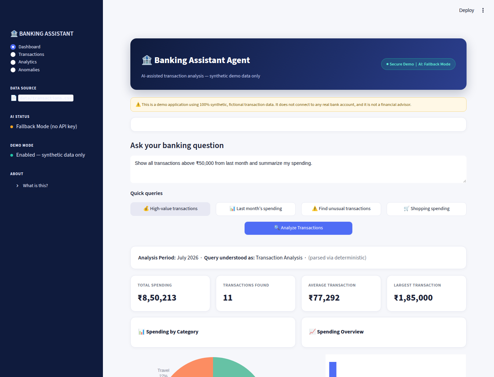
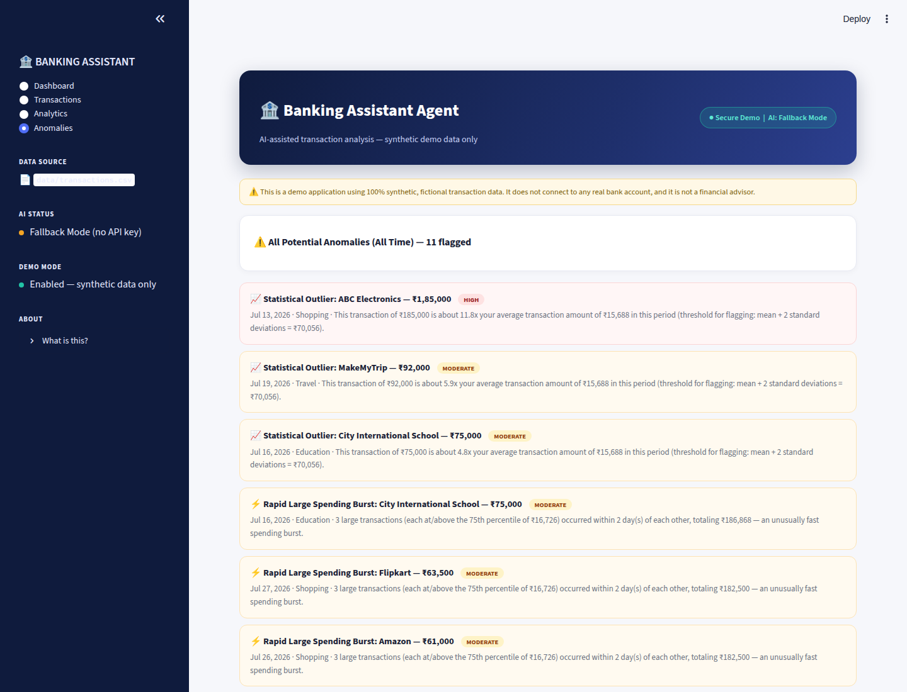
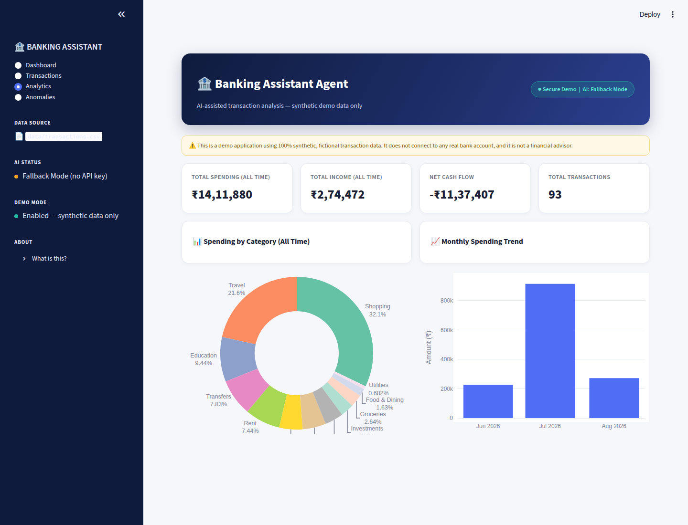
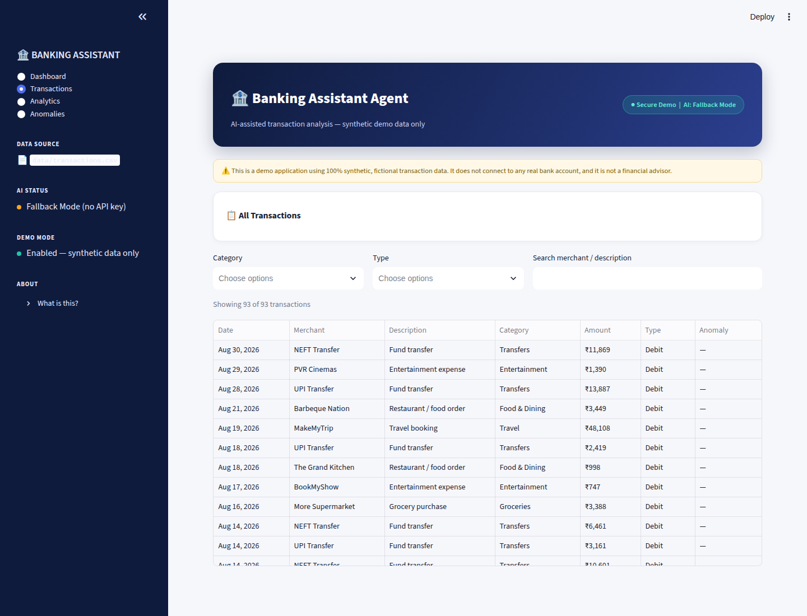

# 🏦 Banking Assistant Agent

An AI-assisted transaction analysis agent that answers natural-language banking questions
against a synthetic transaction dataset — with **all financial math performed
deterministically in Python/Pandas**, and an **optional LLM used only for language
understanding and prose summaries**.

> ⚠️ **This project uses 100% synthetic, fictional transaction data.** It does not connect
> to any real bank account and is not a financial advisor. See [Limitations](#limitations).

---

## Overview

Ask a question like:

> *"Show all transactions above ₹50,000 from last month and summarize my spending."*

...and the agent will parse your intent, pull the right transactions, categorize and total
them, flag anything statistically unusual, and generate a plain-English summary — all
backed by a modern fintech-style Streamlit dashboard.

The project is built to be evaluated, not just demoed: every calculation is unit-tested,
every failure mode (missing files, bad data, unparseable queries, LLM outages) is handled
explicitly, and no number shown to the user is ever invented by an LLM.

## Problem Statement

Design an AI agent capable of understanding a user's banking-related request and performing
transaction analysis: retrieving transactions, understanding the request, filtering,
categorizing, calculating totals, generating a spending summary, highlighting anomalies, and
handling failures gracefully — for the example query above and its many natural variations,
e.g.:

- "Show my transactions above ₹20,000."
- "What did I spend last month?"
- "Show my biggest expenses."
- "How much did I spend on shopping last month?"
- "Find unusual transactions."

## Features

- **Natural-language query understanding** — LLM-assisted (OpenAI or Gemini) with a
  dependency-free deterministic regex/keyword parser as both the fallback and the
  no-API-key default.
- **Deterministic filtering & math** — every total, average, min/max, and percentage is
  computed with Pandas/NumPy. The LLM never touches the dataframe.
- **Automatic categorization** — normalizes known categories and infers missing ones from
  merchant/description keywords.
- **Transparent anomaly detection** — statistical outliers (mean + *k*·σ), duplicate-looking
  charges, and rapid bursts of large transactions, each with a plain-English reason.
- **AI-assisted summaries, numerically grounded** — the summary LLM receives only
  already-computed figures, and its output is checked for invented numbers before being
  shown; falls back to a template summary otherwise.
- **Graceful failure handling** — missing files, corrupt CSVs, missing columns, bad dates/
  amounts, empty results, unparseable queries, and LLM/API outages all degrade to clear
  messages instead of crashes or stack traces.
- **Modern dashboard UI** — KPI cards, category & time-series charts, anomaly cards, an AI
  summary card, a searchable transaction table, and a dark sidebar with live AI/data status.
- **Fully tested** — 48+ automated tests covering filtering boundaries, analytics
  correctness, anomaly detection, and query parsing.

## Architecture

```text
                    USER
                      │
                      ▼
              Streamlit Web Dashboard
                      │
                      ▼
              Natural Language Query
                      │
                      ▼
     AI Query Understanding (LLM or deterministic fallback)
                      │
                      ▼
         Structured Query (Pydantic-validated)
                      │
                      ▼
        Transaction Retriever (TransactionRepository)
                      │
                      ▼
              Transaction Filter (Pandas)
                      │
                      ▼
              Categorization Engine
                      │
                      ▼
               Analytics Engine
                 ┌────┴────┐
                 │         │
              Totals    Category %
                 │         │
                 └────┬────┘
                      ▼
              Anomaly Detection (statistical + rule-based)
                      │
                      ▼
        AI Summary Generator (LLM or template fallback)
                      │
                      ▼
              Results + Insights → Web Dashboard
```

**Agent workflow** (`agent.py`, a single agent with reliable deterministic tools — see
[Agent Design](#agent-design--anomaly-detection) below):

```text
User Query → Query Parser → Retrieve Transactions → Filter → Categorize
           → Calculate → Detect Anomalies → Generate Summary → Return Results
```

## Technology Stack

| Layer            | Technology                                            |
|-------------------|--------------------------------------------------------|
| Backend / core     | Python 3.11+, Pandas, NumPy, Pydantic, `logging`       |
| AI (optional)      | OpenAI-compatible API, or Google Gemini                |
| Frontend           | Streamlit + custom CSS, Plotly charts                  |
| Data               | Local CSV (`data/transactions.csv`), synthetic/demo    |
| Testing            | pytest                                                  |

No API keys are hard-coded anywhere — see [Environment Variables](#environment-variables).
If no key is configured, the app runs fully in **deterministic fallback mode**.

## Project Structure

```text
banking-assistant-agent/
│
├── app.py                       # Streamlit dashboard (presentation only)
├── agent.py                     # Agent orchestration (the pipeline above)
├── config.py                    # Env-based configuration, no hard-coded secrets
├── requirements.txt
├── README.md
├── .env.example
├── .gitignore
│
├── data/
│   ├── transactions.csv               # Synthetic demo dataset
│   ├── transactions_dirty_sample.csv  # Malformed sample used for failure-handling tests/demo
│   └── generate_transactions.py       # Reproducible generator for transactions.csv
│
├── src/
│   ├── data_loader.py            # TransactionRepository: load/validate/normalize CSV
│   ├── query_parser.py           # NL → StructuredQuery (LLM + deterministic fallback)
│   ├── date_utils.py             # Dynamic date-range resolution ("last month", etc.)
│   ├── filters.py                # Deterministic Pandas filtering
│   ├── categorizer.py            # Category validation / normalization / inference
│   ├── analytics.py              # Deterministic totals, averages, category breakdown
│   ├── anomaly_detector.py       # Statistical + rule-based anomaly detection
│   ├── summarizer.py             # AI-assisted / template summary generation
│   └── validators.py             # Pydantic schemas shared across modules
│
├── tests/
│   ├── test_filters.py
│   ├── test_analytics.py
│   ├── test_anomalies.py
│   └── test_query_parser.py
│
├── .streamlit/config.toml        # Theme config
└── assets/screenshots/           # Screenshots for this README
```

## Setup

```bash
git clone <repository>
cd banking-assistant-agent

python -m venv venv

# Windows
venv\Scripts\activate
# macOS / Linux
source venv/bin/activate

pip install -r requirements.txt
```

### Environment Variables

Copy `.env.example` to `.env` and fill in only what you want to use:

```bash
cp .env.example .env
```

```text
# Option A: OpenAI-compatible API
OPENAI_API_KEY=
OPENAI_MODEL=gpt-4o-mini

# Option B: Google Gemini
GOOGLE_API_KEY=
GEMINI_MODEL=gemini-1.5-flash
```

**Both are optional.** With neither key set, the app runs in deterministic fallback mode —
query understanding uses the regex/keyword parser and summaries use the template generator.
Every calculation is identical either way.

### Regenerating the synthetic dataset (optional)

`data/transactions.csv` is already generated and committed, anchored to be useful "as of"
whenever you run the app (it always includes data for the current and previous calendar
month). To regenerate it fresh relative to today's date:

```bash
python data/generate_transactions.py
```

## Run

```bash
streamlit run app.py
```

Then open the local URL Streamlit prints (typically `http://localhost:8501`).

## Example Queries

- `Show all transactions above ₹50,000 from last month and summarize my spending.`
- `Show my transactions above ₹20,000.`
- `What did I spend last month?`
- `Show my biggest expenses.`
- `How much did I spend on shopping last month?`
- `Find unusual transactions.`
- `Show transactions above ₹1 lakh`
- `transactions over 25000 this week`

## Agent Design & Anomaly Detection

**Why a single agent, not multi-agent?** The task decomposes cleanly into a fixed pipeline
of deterministic tools (parse → retrieve → filter → categorize → calculate → detect →
summarize). A single well-designed agent with reliable tools is more correct, more testable,
and more maintainable than simulating multiple "agents" for a workflow that doesn't actually
branch or negotiate between independent actors.

**Anomaly detection** (`src/anomaly_detector.py`) uses three explicit, auditable methods —
never "ask the LLM to find anomalies":

1. **Statistical outliers** — flags a transaction if `amount > mean + k·σ` of that period's
   spending (`k` = `ANOMALY_STD_MULTIPLIER`, default 2.0).
2. **Duplicate-looking transactions** — same merchant, near-identical amount, within a few
   days of each other (possible accidental double charge).
3. **Rapid repeated large transactions** — several large transactions clustered within a
   short window (possible spending spree).

Every flagged transaction includes a human-readable reason, and anomalies are always
described as **"potentially unusual"** — never as fraudulent.

## Failure Handling

| Failure                          | Behavior                                                            |
|-----------------------------------|-----------------------------------------------------------------------|
| Missing `transactions.csv`         | Clear "dataset not found" message, no crash                          |
| Corrupted / unparseable CSV        | "Unable to read transaction data" message                            |
| Missing required columns           | Names exactly which columns are missing                              |
| Invalid dates / amounts in rows    | Those rows are skipped and reported; valid rows still processed      |
| Query with unparseable amount      | "I couldn't determine the transaction amount..." — no guessing        |
| No matching transactions           | Explicit "no transactions found" message — never a fake result       |
| LLM/API failure or missing key     | Silently falls back to deterministic parsing/summary; app keeps working |
| Unexpected exception                | Logged internally; user sees a generic, non-technical error message  |

## Testing

```bash
pytest -q
```

Covers, among others:

- Amount-threshold boundary correctness: `₹50,001` included, `₹50,000` and `₹49,999`
  excluded for "above ₹50,000" (strictly `>`).
- "Last month" resolving to the correct calendar month dynamically (including year
  boundaries) — never hard-coded.
- Category breakdown totals and percentages against hand-computed values.
- Anomaly detection correctly flagging an intentionally injected outlier and *not* flagging
  a tight cluster of normal transactions.
- Multiple natural-language phrasings of the same request (operators, Indian currency
  formats like lakh/crore/k, category keywords, intents).
- Invalid/empty queries raising a helpful, specific error.

## Screenshots


*Dashboard: query box, quick queries, KPI cards, and charts after running the example query.*


*Anomalies page: all flagged transactions with severity and plain-English reasons.*


*Analytics page: all-time spending/income KPIs, category breakdown, and monthly trend.*


*Transactions page: full searchable/filterable transaction browser.*

## Deployment (Streamlit Community Cloud)

1. Push this repository to GitHub (`.env` is git-ignored — never commit real keys).
2. On [share.streamlit.io](https://share.streamlit.io), create a new app pointing at
   `app.py` on your repository's main branch.
3. If you want AI-assisted parsing/summaries in the deployed app, add `OPENAI_API_KEY` or
   `GOOGLE_API_KEY` under the app's **Secrets** — never in the code.
4. The app uses only relative paths (`data/transactions.csv`), so it works unmodified after
   deployment.

## Limitations

- Uses **synthetic, fictional transaction data only** — no real bank connectivity of any
  kind.
- Anomaly detection is statistical/rule-based, not a fraud-detection system, and never
  labels a transaction as fraudulent.
- The deterministic query parser covers a wide range of common phrasings but is not a full
  NLU system; highly ambiguous or multi-part questions are best served by enabling an LLM
  provider.
- Single-account, single-currency (INR) demo scope.

## Future Scope

- Integration with secure, authorized **open-banking / bank APIs** (e.g. Account Aggregator
  frameworks, Plaid-style connectors), subject to proper OAuth-based authentication and
  user consent — not implemented here.
- Multi-account and multi-currency support.
- Persisted user preferences and saved queries.
- Richer anomaly models (seasonality-aware baselines, per-category thresholds).

---

## Final Verification Checklist

- [x] Application runs successfully (`streamlit run app.py`)
- [x] CSV loads correctly
- [x] Transactions are validated
- [x] Natural-language query works
- [x] Amount threshold is extracted correctly
- [x] Last-month calculation is dynamic (computed from `date.today()`, tested across a year
      boundary)
- [x] Filtering is deterministic (Pandas boolean masks, strict `>` for "above")
- [x] Categorization works (normalization + keyword-based inference)
- [x] Spending totals are mathematically correct (unit-tested against known values)
- [x] Category breakdown works (counts, totals, percentages summing to ~100%)
- [x] Anomaly detection works (statistical outliers, duplicates, rapid bursts — all tested)
- [x] AI summary uses calculated data only (structured Pydantic payload; numeric grounding
      check on LLM output)
- [x] No hallucinated financial numbers (grounding check falls back to template summary if
      violated)
- [x] Empty results are handled (explicit message, no fake data)
- [x] Invalid input is handled ("I couldn't determine the transaction amount...")
- [x] Missing files are handled (`DatasetNotFoundError` → friendly message)
- [x] LLM failure is handled (any exception → deterministic fallback, app keeps working)
- [x] API keys are not hard-coded (all via `.env` / environment variables)
- [x] Synthetic data is used (clearly labeled throughout the UI and README)
- [x] UI is polished (custom CSS, KPI cards, sidebar, consistent fintech styling)
- [x] Charts work (Plotly category pie chart + spending-over-time bar chart)
- [x] Tests are included (48+ tests across filters, analytics, anomalies, query parsing)
- [x] README is complete
- [x] Deployment works (relative paths only, pinned `requirements.txt`, Streamlit Cloud
      compatible)

---

*This is a demo/educational project. It is not affiliated with, and does not represent,
any real bank or financial institution.*
