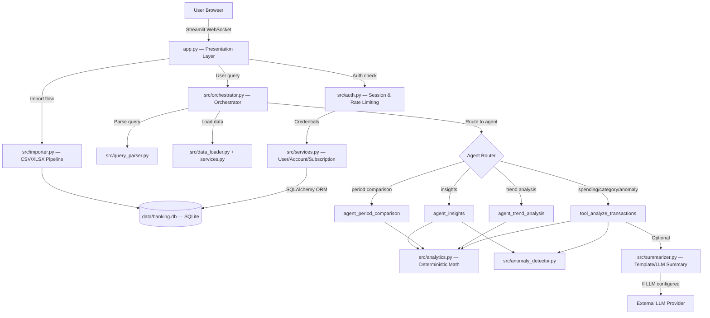

# Architecture — Banking Assistant Agent

## Overview

Banking Assistant Agent is a Streamlit-based fintech application that combines
deterministic financial analytics with optional LLM-powered conversational
assistance. It uses a multi-agent orchestration pattern where an **Orchestrator**
routes user queries to specialized **agent functions**, each backed by shared
deterministic **analytics services**.

## System Diagram



## Key Modules

### Presentation Layer (`app.py`)
- Streamlit pages: Auth, Overview, Transactions, AI Assistant, Data Center, Pricing, Subscription
- Stitch dark navy design system with Plus Jakarta Sans + Inter typography
- Global Standard/AI Mode toggle in header
- All rendering is HTML via `st.markdown(unsafe_allow_html=True)` for design fidelity

### Orchestrator (`src/orchestrator.py`)
The central coordinator. Receives a natural-language query, parses it, loads
user-scoped data, routes to the appropriate agent function, and returns a
structured `ToolResult`.

**Routing logic:**
1. Parse query → `StructuredQuery` (via `src/query_parser.py`)
2. Load user transactions from DB (via `DBTransactionRepository`)
3. Check intent → route to specialized agent or general analysis
4. Collect results, validate, return `ToolResult`

**Intents routed to specialists:**
| Intent | Agent Function | What It Does |
|--------|---------------|--------------|
| `trend_analysis` | `agent_trend_analysis()` | Monthly income/expense trends, top merchants |
| `period_comparison` | `agent_period_comparison()` | Current vs prior period delta analysis |
| `insights_query` | `agent_insights()` | Category breakdown, expense ratio, anomaly summary |
| All others | `tool_analyze_transactions()` | General analytics pipeline |

### Agent Functions
Each agent is a pure function: `(DataFrame, query) -> ToolResult`. No agent
directly accesses the database — data is loaded once by the orchestrator and
passed in, ensuring user-scoping is enforced at a single point.

### Analytics Services (`src/analytics.py`)
All financial math is deterministic (Pandas/NumPy). Functions include:
- `calculate_overall_statistics()` — income, spending, net cash flow, averages
- `calculate_category_breakdown()` — spending by category with percentages
- `period_comparison()` — current vs prior period with percentage changes
- `income_expense_over_time()` — monthly time series
- `spending_over_time()` — daily/weekly spending trends
- `top_merchants()` — most-spent-at merchants

### Anomaly Detection (`src/anomaly_detector.py`)
Three detection strategies:
1. **Statistical outliers** — amounts > 2σ above mean
2. **Duplicate-like** — same merchant, similar amount, within 3 days
3. **Rapid large spending** — 3+ large transactions within 2 days

### Import Pipeline (`src/importer.py`)
Four-step process:
1. **Upload** — CSV/XLSX file validation (type, size, encoding)
2. **Schema mapping** — auto-detection + manual column mapping
3. **Validation** — date parsing, amount normalization, signed-amount handling
4. **Commit** — atomic insert with duplicate detection and rollback on failure

**Signed amounts:** When no explicit type column exists, negative amounts are
treated as Debit (expense), positive as Credit (income). When a type column
is present, amounts must be positive.

### Authentication (`src/auth.py`)
- bcrypt password hashing
- Rate limiting (5 attempts / 300s lockout window, per-username, thread-safe)
- Session tokens via `secrets.token_hex(32)`
- Session expiry (24h default)
- All financial queries scoped by `user_id`

### Subscription & Entitlements (`src/services.py` + `config.py`)
Three distinct access levels:
| Level | How It's Set | What It Grants |
|-------|-------------|----------------|
| **Free** | Default | Dashboard, transactions, data import, deterministic insights |
| **Pro** | Active subscription record | All Free + AI Assistant in AI Mode |
| **Demo** | `DEMO_USERNAMES` env var | Same as Pro, badge shows "PRO · Demo" |

Server-side enforcement: `get_user_plan()` checks the `subscriptions` table,
then `DEMO_USERNAMES`. The UI reflects the backend state, never the reverse.

### LLM Integration
- **Provider**: OpenAI-compatible or Google Gemini (configured via env vars)
- **Fallback**: Without API keys, all queries use deterministic parsing + template summaries
- **Safety**: LLM never invents financial data. It may interpret queries or explain
  verified results. All arithmetic is deterministic.

## Database Schema

```
users (id, username, email, password_hash, is_active, created_at)
  └── financial_accounts (id, user_id, name, account_type, currency)
        └── transactions (id, external_id, account_id, import_id, date,
                         description, merchant, category, txn_type, amount,
                         currency, original_description, created_at)
  └── import_records (id, user_id, filename, file_type, rows_total,
                     rows_imported, rows_skipped, rows_duplicate, status,
                     error_message, created_at)
  └── subscriptions (id, user_id, plan, status, payment_id, payment_provider,
                    started_at, expires_at, created_at)

alembic_version (version_num)
```

All transactions are scoped through `financial_accounts.user_id`. Cross-user
access is prevented by always joining through the user's accounts.

## Data Flow: "Analyze my monthly expenditure"

1. User types query in AI Assistant page
2. `app.py` calls `Orchestrator.run("Analyze my monthly expenditure")`
3. `parse_query()` → `StructuredQuery(intent="spending_summary", date_range="this_month")`
4. `tool_load_transactions(db, user_id)` → loads only this user's transactions
5. Router sees `spending_summary` intent → general analysis path
6. `tool_analyze_transactions()` → filters by date, calculates stats
7. `tool_detect_anomalies()` → checks for unusual transactions
8. `tool_generate_summary()` → template-based or LLM summary
9. `_build_direct_answer()` → formats concise text answer
10. `ToolResult` returned to UI with stats, breakdown, anomalies, summary
11. UI renders answer, charts, and tables

## Standard Mode vs AI Mode

| Aspect | Standard Mode | AI Mode (Pro) |
|--------|--------------|---------------|
| Query parsing | Rule-based regex | Rule-based (same) |
| Financial math | Deterministic | Deterministic (same) |
| Summary text | Template-based | LLM-generated (if configured) |
| Available to | All users | Pro/Demo only |
| Requires API key | No | Yes (for LLM features) |

**Key insight for viva:** Even in AI Mode, all financial calculations are
deterministic. The LLM only affects natural-language understanding and prose
generation — it never invents transaction amounts or account balances.

## Security Controls

1. **Password hashing** — bcrypt with random salt
2. **Rate limiting** — per-username, in-memory, thread-safe
3. **Session management** — 64-char hex token, 24h expiry
4. **User isolation** — all DB queries scoped by user_id
5. **XSS protection** — `html.escape()` on all user-supplied content
6. **Import safety** — file size limits, type validation, atomic commits
7. **Secret management** — all credentials via env vars, never in code
8. **Production guard** — refuses to start with default SECRET_KEY when DATABASE_URL is set
